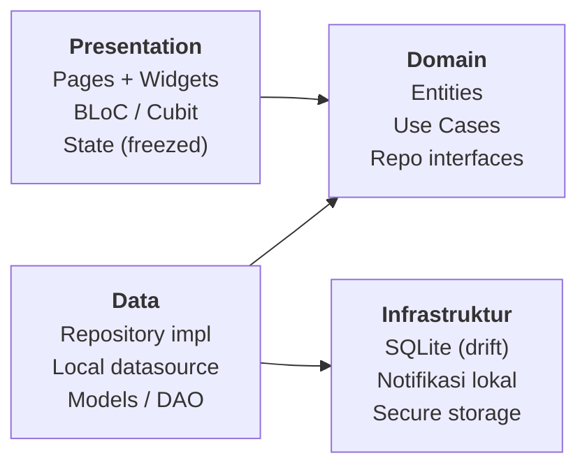
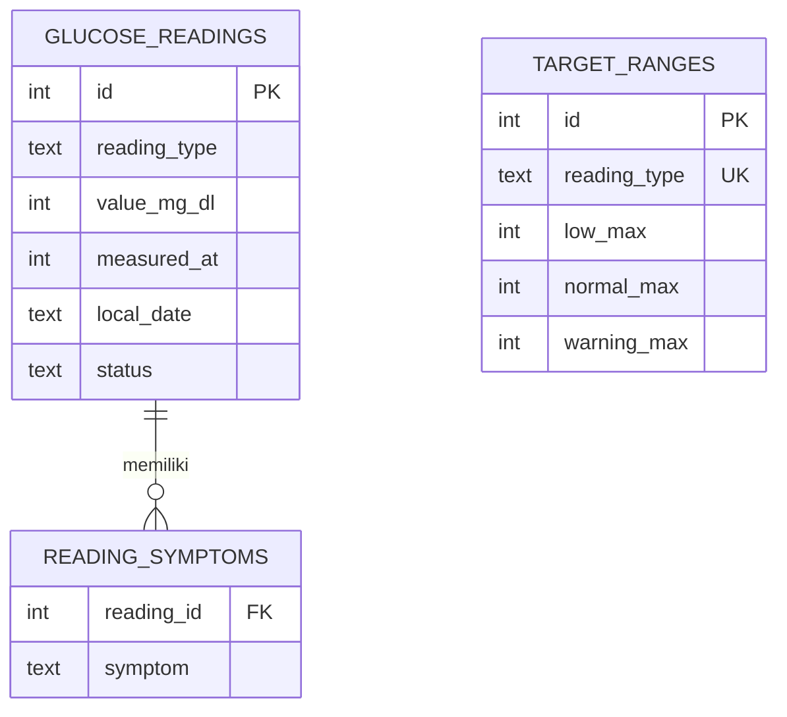

# PRD — GlukoTrack: Aplikasi Pemantau Gula Darah Harian

**Tanggal:** 26 September 2026 · **Penulis:** Adi Purwanto
**Platform:** Flutter (Android & iOS) · **Database:** SQLite (drift) · **Arsitektur:** Clean Architecture

---

## Daftar Isi

1. [Ringkasan Produk](#1-ringkasan-produk)
2. [Target Pengguna dan Persona](#2-target-pengguna-dan-persona)
3. [Ruang Lingkup](#3-ruang-lingkup)
4. [Kebutuhan Fungsional](#4-kebutuhan-fungsional)
5. [Aturan Bisnis](#5-aturan-bisnis)
6. [Desain UX/UI](#6-desain-uxui)
7. [Arsitektur Teknis](#7-arsitektur-teknis)
8. [Desain Database SQLite](#8-desain-database-sqlite)
9. [Kebutuhan Non-Fungsional](#9-kebutuhan-non-fungsional)
10. [Roadmap, Risiko, dan Disclaimer](#10-roadmap-risiko-dan-disclaimer)

---

## 1. Ringkasan Produk

GlukoTrack adalah aplikasi mobile offline-first (Flutter + SQLite) untuk mencatat dan memantau gula darah harian, dengan pemisahan tegas antara **Gula Darah Puasa (GDP)** dan **Gula Darah Sewaktu (GDS)**. Target MVP: pencatatan di bawah 10 detik, tren yang mudah dibaca, dan laporan PDF yang siap dibawa ke dokter.

**Latar belakang.** Pencatatan manual di buku atau catatan HP sulit dianalisis: nilai puasa dan sewaktu tercampur, tren tidak terlihat, dan dokter tidak mendapat ringkasan yang rapi. Aplikasi umum di pasar sering terlalu kompleks, berbahasa Inggris, atau mewajibkan akun cloud.

**Tujuan produk**

1. Mencatat GDP dan GDS dengan cepat, konsisten, dan terpisah.
2. Memberi umpan balik instan (normal, waspada, tinggi, rendah) sesuai target pribadi.
3. Menampilkan tren harian, mingguan, dan bulanan per tipe pengukuran.
4. Menjaga kebiasaan cek rutin lewat pengingat.
5. Menghasilkan laporan untuk konsultasi dokter.
6. Menyimpan data sepenuhnya di perangkat, aman dan privat.

**Metrik keberhasilan**

| Metrik | Target |
| --- | --- |
| Waktu input satu pengukuran | ≤ 10 detik (≤ 3 tap + input angka) |
| Konsistensi cek GDP | ≥ 5 dari 7 hari per minggu |
| Crash-free sessions | ≥ 99,5% |
| Cold start aplikasi | ≤ 2 detik di perangkat mid-range |
| Waktu buat laporan PDF 30 hari | ≤ 3 detik |

---

## 2. Target Pengguna dan Persona

Pengguna utama adalah individu yang rutin memeriksa gula darah sendiri dengan glucometer di rumah, baik untuk memantau risiko maupun mengelola diabetes bersama dokter.

| Persona | Profil | Kebutuhan utama | Masalah saat ini |
| --- | --- | --- | --- |
| Pemantau mandiri (utama) | Dewasa 30–55 th, pekerja, cek GDP tiap pagi dan GDS sesekali | Input cepat, lihat tren, tahu kapan nilai perlu diwaspadai | Catatan tercecer, sulit membedakan puasa vs sewaktu |
| Pasien terkontrol dokter | Rutin kontrol bulanan, minum obat atau insulin | Laporan rapi untuk dokter, pengingat cek dan obat | Harus menyalin ulang catatan saat kontrol |
| Pendamping keluarga (fase lanjut) | Anak atau pasangan yang membantu orang tua | Input untuk orang lain, font besar, alarm nilai ekstrem | Tidak ada notifikasi saat nilai berbahaya |

**Pernyataan masalah.** Pengguna membutuhkan cara yang cepat dan terstruktur untuk mencatat GDP dan GDS secara terpisah, memahami apakah nilainya dalam target, dan membagikan riwayatnya ke dokter, tanpa bergantung pada internet atau akun cloud.

---

## 3. Ruang Lingkup

MVP fokus pada pencatatan, klasifikasi, tren, pengingat, dan keamanan data lokal. Laporan PDF dan log pendukung masuk v1.1; integrasi perangkat di v2.

| Kode | Fitur | Fase |
| --- | --- | --- |
| F-01 | Pencatatan GDP, GDS, dan 2 jam PP | MVP |
| F-02 | Klasifikasi otomatis dan indikator warna | MVP |
| F-03 | Pengaturan target dan satuan (mg/dL, mmol/L) | MVP |
| F-04 | Dashboard ringkasan | MVP |
| F-05 | Riwayat, filter, edit, hapus | MVP |
| F-06 | Grafik tren 7/14/30/90 hari | MVP |
| F-07 | Pengingat cek gula darah | MVP |
| F-08 | Kunci aplikasi (PIN/biometrik) | MVP |
| F-09 | Backup dan restore lokal | MVP |
| F-10 | Onboarding dan profil | MVP |
| F-11 | Peringatan nilai ekstrem + kontak darurat | v1.1 |
| F-12 | Laporan PDF dan ekspor CSV | v1.1 |
| F-13 | Statistik: Time in Range, estimasi HbA1c | v1.1 |
| F-14 | Log obat, makanan, aktivitas, berat badan, HbA1c lab | v1.1 |
| F-15 | Pengingat obat | v1.1 |
| F-16 | Health Connect / HealthKit | v2 |
| F-17 | Glucometer Bluetooth (BLE Glucose Profile) | v2 |
| F-18 | OCR foto layar glucometer | v2 |
| F-19 | Sync cloud + multi-profil keluarga | v2 |

**Di luar lingkup:** diagnosis atau rekomendasi dosis obat/insulin, integrasi CGM (continuous glucose monitor), telemedisin, dan fitur sosial.

---

## 4. Kebutuhan Fungsional

Setiap fitur MVP di bawah punya user story dan acceptance criteria (AC) yang bisa langsung diturunkan jadi test case.

### F-01 Pencatatan gula darah

*Sebagai pengguna, saya ingin mencatat hasil cek gula darah beserta tipenya, agar nilai puasa dan sewaktu tidak tercampur.*

- AC1: Tipe pengukuran wajib dipilih: Puasa, Sewaktu, atau 2 Jam Setelah Makan.
- AC2: Nilai wajib diisi, angka bulat 20–600 mg/dL (atau 1,1–33,3 mmol/L); di luar rentang ditolak dengan pesan jelas.
- AC3: Tanggal dan jam default = saat ini, bisa diubah, tidak boleh di masa depan.
- AC4: Tipe Puasa menampilkan konfirmasi "Sudah puasa minimal 8 jam?"; jika tidak, sarankan ganti ke Sewaktu.
- AC5: Tipe Sewaktu punya konteks opsional: sebelum makan, setelah makan (jam ke-), saat bangun, sebelum tidur, atau lainnya.
- AC6: Field opsional: gejala (multi-pilih: pusing, gemetar, berkeringat, haus, lemas, pandangan kabur), catatan maks 500 karakter.
- AC7: Setelah simpan, tampil status hasil (warna + label) dan kembali ke dashboard; data tersimpan walau aplikasi ditutup.
- AC8: Tipe default disarankan otomatis: Puasa jika jam 04.00–09.00 dan belum ada GDP hari itu, selain itu Sewaktu.

### F-02 Klasifikasi otomatis

*Sebagai pengguna, saya ingin tahu langsung apakah hasil saya normal, agar bisa segera bertindak.*

- AC1: Setiap pembacaan diberi status Rendah, Normal, Waspada, atau Tinggi berdasarkan ambang tipe masing-masing (lihat bagian 5).
- AC2: Status disimpan bersama pembacaan (snapshot), sehingga perubahan target tidak mengubah status data lama, kecuali pengguna memilih "Hitung ulang".
- AC3: Status selalu ditampilkan dengan warna, ikon, dan teks, tidak hanya warna.

### F-03 Pengaturan target dan satuan

- AC1: Pengguna bisa mengubah batas Rendah, Normal atas, dan Waspada atas untuk tiap tipe.
- AC2: Validasi: batas harus naik berurutan (rendah < normal < waspada).
- AC3: Tombol "Kembalikan ke default" tersedia.
- AC4: Satuan global mg/dL atau mmol/L; data selalu disimpan dalam mg/dL, konversi hanya di tampilan.

### F-04 Dashboard

*Sebagai pengguna, saya ingin melihat kondisi hari ini dalam satu layar.*

- AC1: Kartu "Puasa hari ini" dan "Sewaktu terakhir" berisi nilai, jam, dan status; kosong → ajakan "Catat sekarang".
- AC2: Rata-rata 7 hari untuk GDP dan GDS, ditampilkan terpisah dengan perubahan vs 7 hari sebelumnya (naik/turun).
- AC3: Mini chart 7 hari dan daftar 5 pembacaan terakhir.
- AC4: Tombol utama (FAB) "+ Catat" selalu terlihat.

### F-05 Riwayat

- AC1: Daftar dikelompokkan per tanggal, terbaru di atas, dengan paginasi 30 item (lazy load).
- AC2: Filter tipe (Semua, Puasa, Sewaktu, 2 Jam PP), status, dan rentang tanggal.
- AC3: Tap item → detail; bisa edit dan hapus (hapus dengan konfirmasi dan opsi Undo 5 detik).
- AC4: Tampilan kalender dengan titik warna per hari sesuai status terburuk hari itu.

### F-06 Grafik tren

- AC1: Periode 7, 14, 30, 90 hari; garis GDP dan GDS terpisah (bisa toggle).
- AC2: Pita hijau menandai rentang target; titik diwarnai sesuai status.
- AC3: Tap titik menampilkan nilai, tanggal, dan jam.
- AC4: Ringkasan periode: rata-rata, min, maks, jumlah pembacaan per tipe.

### F-07 Pengingat

- AC1: Pengingat cek puasa harian (default 06.00) dan pengingat tambahan dengan jam serta hari yang bisa diatur.
- AC2: Notifikasi lokal tetap berjalan setelah reboot perangkat.
- AC3: Tap notifikasi membuka form input dengan tipe sudah terisi.
- AC4: Pengingat puasa dilewati otomatis bila GDP hari itu sudah tercatat.

### F-08 Kunci aplikasi

- AC1: PIN 6 digit opsional, dengan biometrik sebagai alternatif.
- AC2: Kunci aktif saat aplikasi dibuka atau kembali dari background > 1 menit.
- AC3: Konten aplikasi tersembunyi di app switcher (FLAG_SECURE / blur).

### F-09 Backup dan restore

- AC1: Ekspor database ke file terenkripsi (.gtbak) lewat share sheet (simpan lokal, Google Drive, WhatsApp).
- AC2: Restore memvalidasi versi skema dan checksum sebelum menimpa; ada konfirmasi.
- AC3: Tanggal backup terakhir ditampilkan di Pengaturan, dengan pengingat jika > 30 hari.

### F-10 Onboarding dan profil

- AC1: Maksimal 4 layar: sambutan, disclaimer medis (wajib disetujui), satuan, dan jam pengingat puasa.
- AC2: Profil opsional: nama, tahun lahir, jenis diabetes (Tidak ada / Prediabetes / Tipe 1 / Tipe 2 / Gestasional / Tidak tahu), yang menentukan preset target.

### Fitur v1.1 (ringkas)

- **F-11 Peringatan ekstrem:** nilai < 54 atau > 300 mg/dL (bisa diatur) memunculkan layar peringatan, panduan umum, dan tombol telepon kontak darurat.
- **F-12 Laporan:** PDF per periode (profil, target, tabel harian GDP/GDS, grafik, statistik), ekspor CSV, bagikan via share sheet.
- **F-13 Statistik:** Time in Range per tipe, estimasi HbA1c (GMI) dengan label "estimasi", bandingkan dengan HbA1c lab.
- **F-14 Log pendukung:** obat dan dosis, makanan, aktivitas, berat badan, HbA1c lab, dapat ditautkan ke pembacaan.
- **F-15 Pengingat obat:** jadwal per obat, tandai sudah/belum diminum.

---

## 5. Aturan Bisnis

Klasifikasi memakai empat ambang per tipe pengukuran, dengan dua preset bawaan yang bisa diubah pengguna. Semua nilai disimpan dalam mg/dL.

### 5.1 Preset ambang (mg/dL)

Preset "Umum" mengacu pada kriteria diagnostik ADA/PERKENI; preset "Diabetes" mengacu pada target terapi umum ADA. Keduanya wajib diberi keterangan agar dikonfirmasi dengan dokter.

| Preset | Tipe | Rendah | Normal | Waspada | Tinggi |
| --- | --- | --- | --- | --- | --- |
| Umum | Puasa | < 70 | 70–99 | 100–125 | ≥ 126 |
| Umum | Sewaktu | < 70 | 70–139 | 140–199 | ≥ 200 |
| Umum | 2 Jam PP | < 70 | 70–139 | 140–199 | ≥ 200 |
| Diabetes | Puasa | < 70 | 70–130 | 131–180 | > 180 |
| Diabetes | Sewaktu | < 70 | 70–180 | 181–250 | > 250 |
| Diabetes | 2 Jam PP | < 70 | 70–180 | 181–250 | > 250 |

Preset dipilih otomatis saat onboarding: "Tidak ada" atau "Tidak tahu" → Umum; Prediabetes → Umum; Tipe 1/2/Gestasional → Diabetes.

### 5.2 Algoritma klasifikasi

```
if value < lowMax            -> RENDAH
else if value <= normalMax   -> NORMAL
else if value <= warningMax  -> WASPADA
else                         -> TINGGI

isCritical = value < criticalLow (54) || value > criticalHigh (300)
```

### 5.3 Konversi satuan

```
mmol/L = mg/dL ÷ 18,0
```

- Tampilan mmol/L dibulatkan 1 desimal; input mmol/L dikonversi dan dibulatkan ke mg/dL bulat sebelum disimpan.
- Ambang target juga disimpan dalam mg/dL.

### 5.4 Statistik (v1.1)

```
GMI (%) = 3,31 + 0,02392 × rata-rata gula darah (mg/dL)
```

- GMI dihitung dari rata-rata semua pembacaan 30 hari, minimal 14 pembacaan; di bawah itu tampil "Data belum cukup".
- Time in Range = jumlah pembacaan berstatus Normal ÷ total pembacaan tipe tersebut dalam periode.

### 5.5 Validasi dan aturan data

- Rentang nilai valid: 20–600 mg/dL (batas umum glucometer rumahan).
- Maksimal satu GDP per tanggal kalender; input GDP kedua memunculkan pilihan: ganti yang lama, simpan sebagai Sewaktu, atau batal.
- Waktu pengukuran tidak boleh di masa depan; boleh mundur hingga 1 tahun.
- Hapus bersifat soft delete (`deleted_at`) selama 30 hari agar Undo dan restore aman, lalu dibersihkan otomatis.
- Hari dihitung berdasarkan zona waktu perangkat saat pengukuran (disimpan offset-nya).

---

## 6. Desain UX/UI

UI mengikuti Material 3 dengan gaya bersih: satu aksi utama per layar, angka besar, warna status yang konsisten, dan navigasi bawah 4 tab.

### 6.1 Prinsip desain

- **Cepat:** input ≤ 3 tap + angka; keypad numerik langsung terbuka.
- **Jelas:** angka gula darah tampil besar (≥ 40sp), status selalu warna + ikon + teks.
- **Tenang:** palet netral, warna hanya untuk status; hindari bahasa menakutkan.
- **Inklusif:** mendukung font sistem hingga 200%, kontras WCAG AA, target sentuh ≥ 48dp.
- **Bahasa Indonesia** sebagai default, siap i18n (English).

### 6.2 Design system

| Token | Light | Dark | Kegunaan |
| --- | --- | --- | --- |
| primary | #0E7C86 | #4FB8C0 | Aksi utama, FAB, tab aktif |
| surface | #FFFFFF | #121417 | Latar kartu |
| background | #F5F7F8 | #0B0D0F | Latar layar |
| status.low | #7C3AED | #A78BFA | Rendah |
| status.normal | #16A34A | #4ADE80 | Normal |
| status.warning | #D97706 | #FBBF24 | Waspada |
| status.high | #DC2626 | #F87171 | Tinggi |
| textPrimary | #1F2933 | #E5E7EB | Teks utama |

| Elemen | Spesifikasi |
| --- | --- |
| Font | Plus Jakarta Sans (fallback Roboto / SF Pro) |
| Angka utama | 44sp, Bold, tabular figures |
| Judul / body / caption | 20sp SemiBold / 16sp Regular / 12sp Medium |
| Spacing | Skala 4dp: 4, 8, 12, 16, 24, 32 |
| Radius | Kartu 16dp, tombol 12dp, chip 8dp |
| Ikon status | Rendah ↓, Normal ✓, Waspada !, Tinggi ↑ |

### 6.3 Navigasi

Bottom navigation: **Beranda · Riwayat · Tren · Pengaturan**, ditambah FAB "+ Catat" di Beranda dan Riwayat. Form input tampil sebagai bottom sheet penuh agar konteks tetap terasa.

### 6.4 Spesifikasi layar

| Kode | Layar | Komponen utama |
| --- | --- | --- |
| S-01 | Splash / Kunci | Logo, input PIN atau prompt biometrik |
| S-02 | Onboarding (4 langkah) | Sambutan, disclaimer (checkbox wajib), satuan, jam pengingat |
| S-03 | Beranda | Sapaan + tanggal, kartu GDP hari ini, kartu GDS terakhir, rata-rata 7 hari, mini chart, 5 catatan terakhir, FAB |
| S-04 | Catat (bottom sheet) | Segmented tipe, input angka besar, waktu, chip konteks, gejala, catatan, tombol Simpan |
| S-05 | Hasil tersimpan | Nilai + status besar, pesan singkat, tombol Selesai / Catat lagi |
| S-06 | Riwayat | Toggle List / Kalender, chip filter tipe, item: jam, tipe, nilai, badge status |
| S-07 | Detail catatan | Semua field, tombol Edit dan Hapus |
| S-08 | Tren | Segmented periode, chart, toggle GDP/GDS, kartu statistik |
| S-09 | Pengaturan | Profil, target, satuan, pengingat, keamanan, backup, tentang/disclaimer |
| S-10 | Target | Pilih preset, slider/input ambang per tipe, pratinjau pita warna |
| S-11 | Pengingat | Daftar pengingat, toggle aktif, tambah (jam, hari, tipe) |

### 6.5 Wireframe kunci

```
S-03 BERANDA                      S-04 CATAT (bottom sheet)
+------------------------------+  +------------------------------+
| Selamat pagi, Adi            |  |  Catat Gula Darah        [x] |
| Sabtu, 26 Sep 2026           |  | [ Puasa ][Sewaktu][2 Jam PP] |
|                              |  |                              |
| +--------------------------+ |  |            112               |
| | PUASA HARI INI           | |  |           mg/dL              |
| |  98 mg/dL   (v) Normal   | |  |       ! Waspada (live)       |
| |  06.12                   | |  |                              |
| +--------------------------+ |  |  Waktu   Hari ini, 06.12  >  |
| +--------------------------+ |  |  Konteks (Sebelum makan)     |
| | SEWAKTU TERAKHIR         | |  |          (Setelah makan) ... |
| | 156 mg/dL  (!) Waspada   | |  |  Gejala  (Pusing)(Lemas) ... |
| | Kemarin 20.30            | |  |  Catatan ____________        |
| +--------------------------+ |  |                              |
| Rata-rata 7 hari             |  |  [ 1 ][ 2 ][ 3 ]             |
|  GDP 101 (-3)  GDS 148 (+6)  |  |  [ 4 ][ 5 ][ 6 ]             |
| [ mini chart 7 hari ]        |  |  [ 7 ][ 8 ][ 9 ]             |
| Terakhir ...                 |  |  [ , ][ 0 ][<-]              |
|                     [+ Catat]|  |  [        SIMPAN          ]  |
| Beranda Riwayat Tren Setelan |  +------------------------------+
+------------------------------+
```

**Microcopy status (contoh):**

- Normal → "Bagus, sesuai target."
- Waspada → "Sedikit di atas target. Perhatikan pola makan hari ini."
- Tinggi → "Di atas target. Catat dan pantau; hubungi dokter bila berulang."
- Rendah → "Di bawah target. Segera konsumsi gula cepat serap bila ada gejala."

**Empty state:** ilustrasi sederhana + "Belum ada catatan. Mulai dengan cek gula darah puasa besok pagi."

---

## 7. Arsitektur Teknis

Aplikasi dibangun dengan Flutter, Clean Architecture berstruktur feature-first, flutter_bloc untuk state, dan SQLite melalui drift sebagai satu-satunya penyimpanan (offline-first).



Panah = arah dependensi. Presentation hanya memanggil use case; Data mengimplementasikan interface repository milik Domain, sehingga database bisa diganti tanpa menyentuh logika bisnis. Domain murni Dart, tidak bergantung pada Flutter, SQLite, atau layer lain.

### 7.1 Tech stack

| Kebutuhan | Paket | Alasan |
| --- | --- | --- |
| Framework | Flutter 3.x stable, Dart 3 | Satu codebase Android + iOS |
| State management | flutter_bloc, bloc_test | Pola event → state yang mudah dites |
| Dependency injection | get_it + injectable | Registrasi otomatis per layer |
| Database | drift + sqlite3_flutter_libs | SQLite type-safe, migrasi terkelola, query reaktif (Stream) |
| Enkripsi DB | sqlcipher_flutter_libs | Enkripsi file SQLite at-rest |
| Error handling | fpdart (`Either<Failure, T>`) | Error eksplisit tanpa exception bocor ke UI |
| Model immutable | freezed, json_serializable | Entity, state, dan DTO backup |
| Routing | go_router | Deep link dari notifikasi |
| Grafik | fl_chart | Line chart + pita target |
| Notifikasi | flutter_local_notifications, timezone | Pengingat terjadwal |
| Keamanan | local_auth, flutter_secure_storage | Biometrik, kunci DB, hash PIN |
| Backup / share | share_plus, file_picker, path_provider | Ekspor & impor file |
| PDF (v1.1) | pdf, printing | Laporan dokter |
| Lokalisasi | flutter_localizations, intl (gen-l10n) | ID default, siap EN |
| Kualitas | very_good_analysis, mocktail, integration_test | Lint ketat & testing |

### 7.2 Struktur folder

```
lib/
├── main.dart
├── app.dart
├── core/
│   ├── di/                  # injection.dart (get_it + injectable)
│   ├── error/               # failures.dart, exceptions.dart
│   ├── usecase/             # usecase.dart (base class)
│   ├── router/              # app_router.dart (go_router)
│   ├── theme/               # colors, typography, app_theme.dart
│   ├── utils/               # unit_converter.dart, date_utils.dart
│   └── widgets/             # komponen bersama: StatusBadge, GlucoseValueText
├── database/
│   ├── app_database.dart    # @DriftDatabase + migration strategy
│   ├── tables/              # glucose_readings.dart, target_ranges.dart, ...
│   └── daos/                # glucose_dao.dart, target_dao.dart, reminder_dao.dart
└── features/
    ├── glucose/
    │   ├── domain/
    │   │   ├── entities/        # glucose_reading.dart, enums.dart
    │   │   ├── repositories/    # glucose_repository.dart (abstract)
    │   │   └── usecases/        # add_reading, update_reading, delete_reading,
    │   │                        # get_readings, watch_dashboard_summary, classify_reading
    │   ├── data/
    │   │   ├── datasources/     # glucose_local_datasource.dart
    │   │   ├── mappers/         # reading_mapper.dart (row <-> entity)
    │   │   └── repositories/    # glucose_repository_impl.dart
    │   └── presentation/
    │       ├── bloc/            # dashboard_bloc, reading_form_cubit, history_bloc
    │       ├── pages/           # dashboard_page, history_page, reading_detail_page
    │       └── widgets/         # reading_card, input_sheet, numeric_keypad
    ├── trend/               # grafik & statistik
    ├── target/              # pengaturan ambang & preset
    ├── reminder/            # pengingat & scheduler
    ├── security/            # PIN, biometrik, app lock
    ├── backup/              # ekspor/impor database
    ├── onboarding/
    └── profile/
```

### 7.3 Contoh kontrak inti

```dart
// domain/entities/glucose_reading.dart
@freezed
class GlucoseReading with _$GlucoseReading {
  const factory GlucoseReading({
    int? id,
    required ReadingType type,       // fasting, random, postprandial2h
    required int valueMgDl,
    required DateTime measuredAt,
    required GlucoseStatus status,   // low, normal, warning, high
    required bool isCritical,
    MealContext? mealContext,
    @Default([]) List<Symptom> symptoms,
    String? note,
  }) = _GlucoseReading;
}

// domain/repositories/glucose_repository.dart
abstract interface class GlucoseRepository {
  Future<Either<Failure, GlucoseReading>> add(GlucoseReading reading);
  Future<Either<Failure, Unit>> update(GlucoseReading reading);
  Future<Either<Failure, Unit>> softDelete(int id);
  Stream<List<GlucoseReading>> watchByRange(DateRange range, {ReadingType? type});
  Future<Either<Failure, GlucoseReading?>> fastingOn(DateTime date);
}

// domain/usecases/add_reading.dart
class AddReading implements UseCase<GlucoseReading, AddReadingParams> {
  AddReading(this._repo, this._targets, this._classify);
  final GlucoseRepository _repo;
  final TargetRepository _targets;
  final ClassifyReading _classify;

  @override
  Future<Either<Failure, GlucoseReading>> call(AddReadingParams p) async {
    // 1. validasi rentang & waktu  2. cek duplikat GDP
    // 3. ambil target aktif        4. klasifikasi  5. simpan
  }
}
```

### 7.4 Alur data: menyimpan pembacaan

1. Pengguna menekan **Simpan** → `ReadingFormCubit.submit()`.
2. Cubit memanggil use case `AddReading` dengan parameter dari form.
3. `AddReading` memvalidasi nilai, mengecek GDP ganda, mengambil target aktif, lalu memanggil `ClassifyReading`.
4. `GlucoseRepositoryImpl` memetakan entity ke row drift dan menyimpan lewat `GlucoseDao`.
5. Query `watchByRange` (Stream drift) otomatis memancarkan data baru → `DashboardBloc` dan `HistoryBloc` ter-update tanpa refresh manual.
6. Kegagalan dikembalikan sebagai `Left(Failure)` dan ditampilkan sebagai snackbar/pesan field.

### 7.5 Aturan arsitektur

- Layer `domain` tidak boleh import `package:flutter` atau `drift` (dicek via lint rule/`import_lint`).
- BLoC hanya bergantung pada use case, tidak pada repository atau DAO.
- Setiap use case satu tanggung jawab dan punya unit test.
- Konversi satuan hanya terjadi di presentation (formatter), bukan di domain maupun data.

---

## 8. Desain Database SQLite

MVP memakai 6 tabel dalam satu file SQLite terenkripsi (SQLCipher), dikelola drift dengan `schemaVersion` dan migrasi bertahap. Semua waktu disimpan sebagai epoch milidetik UTC plus offset zona waktu.

**Relasi:** `glucose_readings` 1–N `reading_symptoms`; `target_ranges` berisi satu baris per tipe pengukuran; `user_profile` satu baris; `reminders` dan `app_settings` berdiri sendiri.



### 8.1 Skema tabel (MVP)

| Tabel | Kolom utama | Keterangan |
| --- | --- | --- |
| user_profile | id (=1), name, birth_year, diabetes_type, unit, preset, onboarding_done, created_at, updated_at | Satu baris profil |
| target_ranges | id, reading_type (unique), low_max, normal_max, warning_max, critical_low, critical_high, updated_at | Ambang per tipe, mg/dL |
| glucose_readings | id, reading_type, value_mg_dl, measured_at, tz_offset_min, local_date, status, is_critical, meal_context, hours_after_meal, note, source, created_at, updated_at, deleted_at | Tabel inti |
| reading_symptoms | reading_id (FK), symptom | Junction gejala, PK gabungan |
| reminders | id, label, reading_type, time_of_minutes, days_mask, is_active, created_at | days_mask: bit 0 = Senin … bit 6 = Minggu |
| app_settings | key (PK), value | Key-value: last_backup_at, lock_enabled, dsb. |

### 8.2 DDL

```sql
CREATE TABLE user_profile (
  id              INTEGER PRIMARY KEY CHECK (id = 1),
  name            TEXT,
  birth_year      INTEGER,
  diabetes_type   TEXT NOT NULL DEFAULT 'unknown',
  unit            TEXT NOT NULL DEFAULT 'mg_dl' CHECK (unit IN ('mg_dl','mmol_l')),
  preset          TEXT NOT NULL DEFAULT 'general',
  onboarding_done INTEGER NOT NULL DEFAULT 0,
  created_at      INTEGER NOT NULL,
  updated_at      INTEGER NOT NULL
);

CREATE TABLE target_ranges (
  id            INTEGER PRIMARY KEY AUTOINCREMENT,
  reading_type  TEXT NOT NULL UNIQUE
                CHECK (reading_type IN ('fasting','random','postprandial_2h')),
  low_max       INTEGER NOT NULL,
  normal_max    INTEGER NOT NULL,
  warning_max   INTEGER NOT NULL,
  critical_low  INTEGER NOT NULL DEFAULT 54,
  critical_high INTEGER NOT NULL DEFAULT 300,
  updated_at    INTEGER NOT NULL,
  CHECK (low_max < normal_max AND normal_max < warning_max)
);

CREATE TABLE glucose_readings (
  id               INTEGER PRIMARY KEY AUTOINCREMENT,
  reading_type     TEXT NOT NULL
                   CHECK (reading_type IN ('fasting','random','postprandial_2h')),
  value_mg_dl      INTEGER NOT NULL CHECK (value_mg_dl BETWEEN 20 AND 600),
  measured_at      INTEGER NOT NULL,          -- epoch ms UTC
  tz_offset_min    INTEGER NOT NULL,
  local_date       TEXT NOT NULL,             -- 'YYYY-MM-DD'
  status           TEXT NOT NULL CHECK (status IN ('low','normal','warning','high')),
  is_critical      INTEGER NOT NULL DEFAULT 0,
  meal_context     TEXT,                      -- before_meal, after_meal, wake_up, bedtime, other
  hours_after_meal REAL,
  note             TEXT CHECK (length(note) <= 500),
  source           TEXT NOT NULL DEFAULT 'manual',
  created_at       INTEGER NOT NULL,
  updated_at       INTEGER NOT NULL,
  deleted_at       INTEGER
);

CREATE TABLE reading_symptoms (
  reading_id INTEGER NOT NULL REFERENCES glucose_readings(id) ON DELETE CASCADE,
  symptom    TEXT NOT NULL,
  PRIMARY KEY (reading_id, symptom)
);

CREATE TABLE reminders (
  id              INTEGER PRIMARY KEY AUTOINCREMENT,
  label           TEXT NOT NULL,
  reading_type    TEXT,
  time_of_minutes INTEGER NOT NULL CHECK (time_of_minutes BETWEEN 0 AND 1439),
  days_mask       INTEGER NOT NULL DEFAULT 127,
  is_active       INTEGER NOT NULL DEFAULT 1,
  created_at      INTEGER NOT NULL
);

CREATE TABLE app_settings (
  key   TEXT PRIMARY KEY,
  value TEXT
);

-- Indeks
CREATE INDEX idx_readings_measured ON glucose_readings(measured_at DESC)
  WHERE deleted_at IS NULL;
CREATE INDEX idx_readings_type_date ON glucose_readings(reading_type, local_date)
  WHERE deleted_at IS NULL;
CREATE UNIQUE INDEX ux_fasting_per_day ON glucose_readings(local_date)
  WHERE reading_type = 'fasting' AND deleted_at IS NULL;
```

### 8.3 Tabel tambahan v1.1

| Tabel | Kolom utama |
| --- | --- |
| medications | id, name, dose, unit, schedule_json, is_active |
| medication_logs | id, medication_id, taken_at, status, reading_id (opsional) |
| lab_results | id, test_type (hba1c), value, tested_at, note |
| meal_logs | id, eaten_at, description, carb_level, reading_id (opsional) |
| activity_logs | id, started_at, type, duration_min |
| weight_logs | id, measured_at, weight_kg |
| emergency_contacts | id, name, phone, relation |

### 8.4 Migrasi dan integritas

- `PRAGMA foreign_keys = ON` dan `journal_mode = WAL` diaktifkan di `beforeOpen`.
- Seed awal (`onCreate`): 3 baris `target_ranges` sesuai preset dan 1 pengingat puasa 06.00.
- Migrasi memakai `stepByStep` drift; skema tiap versi di-dump (`drift_dev schema dump`) dan dites dengan `SchemaVerifier`.
- File backup menyimpan `schema_version` dan checksum SHA-256; restore versi lebih lama menjalankan migrasi, versi lebih baru ditolak.
- Job pembersihan saat aplikasi dibuka menghapus permanen baris `deleted_at` > 30 hari.

---

## 9. Kebutuhan Non-Fungsional

Aplikasi wajib berfungsi penuh tanpa internet, tidak mengirim data ke mana pun, dan tetap responsif dengan 5 tahun data (± 7.000 pembacaan).

| Kode | Kategori | Kebutuhan |
| --- | --- | --- |
| NFR-01 | Platform | Android 8.0+ (API 26), iOS 14+; ponsel, orientasi portrait |
| NFR-02 | Performa | Cold start ≤ 2 dtk; simpan ≤ 200 ms; buka riwayat 30 hari ≤ 300 ms; UI 60 fps |
| NFR-03 | Skala data | Query dashboard & grafik tetap ≤ 300 ms pada 10.000 baris |
| NFR-04 | Offline | Seluruh fitur MVP tanpa koneksi; tanpa izin INTERNET di build MVP |
| NFR-05 | Keamanan | DB terenkripsi SQLCipher; kunci acak 256-bit di Keystore/Keychain; PIN disimpan sebagai hash (Argon2/PBKDF2 + salt) |
| NFR-06 | Privasi | Tanpa akun, analytics, atau iklan; data hanya keluar lewat ekspor yang dipicu pengguna |
| NFR-07 | Keandalan | Crash-free ≥ 99,5%; transaksi DB atomik; backup terverifikasi checksum |
| NFR-08 | Aksesibilitas | Kontras WCAG AA, dukung text scale 200%, label Semantics untuk TalkBack/VoiceOver, target sentuh ≥ 48dp |
| NFR-09 | Lokalisasi | Bahasa Indonesia default, English siap; format angka & tanggal id_ID |
| NFR-10 | Ukuran | APK/IPA ≤ 25 MB |
| NFR-11 | Maintainability | Lint very_good_analysis tanpa warning; coverage domain ≥ 90%, data ≥ 80%, total ≥ 70% |

### 9.1 Strategi testing

- **Unit test:** semua use case, `ClassifyReading`, konverter satuan, validasi, mapper.
- **Repository/DAO test:** drift dengan database in-memory (`NativeDatabase.memory()`), termasuk unique index GDP per hari.
- **BLoC test:** `bloc_test` untuk setiap event/state utama (dashboard, form, riwayat, target).
- **Widget test:** form input, badge status, empty state, golden test untuk light/dark.
- **Migration test:** `SchemaVerifier` untuk setiap kenaikan versi skema.
- **Integration test:** alur onboarding → catat GDP → lihat dashboard → edit → hapus/undo → backup/restore.

### 9.2 CI/CD

- GitHub Actions: `flutter analyze`, `flutter test --coverage`, build APK debug per PR.
- Rilis: Fastlane ke Play Console internal testing dan TestFlight.

---

## 10. Roadmap, Risiko, dan Disclaimer

MVP direncanakan 5 sprint (10 minggu, sprint 2 minggu), dilanjutkan v1.1 selama 6 minggu. Tanggal mulai belum ditentukan, jadi jadwal dihitung dalam minggu relatif.

### 10.1 Milestone

| Sprint | Minggu | Deliverable | Fitur |
| --- | --- | --- | --- |
| 1 | 1–2 | Fondasi: struktur Clean Architecture, DI, theme & design system, skema drift + migrasi, onboarding, profil | F-10 |
| 2 | 3–4 | Form catat, klasifikasi, pengaturan target & satuan | F-01, F-02, F-03 |
| 3 | 5–6 | Dashboard, riwayat list + kalender, detail, edit, hapus + undo | F-04, F-05 |
| 4 | 7–8 | Grafik tren, pengingat, kunci aplikasi, backup/restore | F-06 – F-09 |
| 5 | 9–10 | QA, aksesibilitas, performa, beta internal, rilis MVP | Semua MVP |
| v1.1 | 11–16 | Peringatan ekstrem, laporan PDF/CSV, statistik, log pendukung, pengingat obat | F-11 – F-15 |
| v2 | Setelah 16 | Health Connect/HealthKit, glucometer BLE, OCR, sync & multi-profil | F-16 – F-19 |

**Definition of Done per fitur:** AC terpenuhi, unit + BLoC test lulus, tanpa warning lint, diuji di 1 perangkat Android dan 1 iOS, mendukung dark mode dan text scale 200%.

### 10.2 Risiko dan mitigasi

| Risiko | Dampak | Mitigasi |
| --- | --- | --- |
| Data hilang saat ganti/rusak HP | Tinggi | Pengingat backup 30 hari, backup ke Google Drive via share sheet |
| Pengguna salah pilih tipe (puasa vs sewaktu) | Sedang | Tipe default berdasarkan jam, konfirmasi puasa 8 jam, edit mudah |
| Ambang default tidak sesuai kondisi pengguna | Sedang | Preset per jenis diabetes, target bisa diubah, anjuran konfirmasi dokter |
| Notifikasi dimatikan sistem (battery optimizer) | Sedang | Exact alarm permission, panduan whitelist baterai per merek HP |
| Lupa PIN mengunci data | Tinggi | Pemulihan via biometrik atau restore backup; peringatan saat set PIN |
| Aplikasi dianggap alat medis (regulasi) | Sedang | Posisikan sebagai alat pencatatan, tanpa diagnosis atau rekomendasi dosis |

### 10.3 Pertanyaan terbuka

- [ ] Apakah MVP cukup Android dulu, atau langsung Android + iOS?
- [ ] Apakah tipe "2 Jam Setelah Makan" dimasukkan di MVP atau cukup GDP dan GDS?
- [ ] Nama aplikasi final (GlukoTrack adalah nama kerja).

### 10.4 Disclaimer medis

Teks berikut tampil di onboarding (wajib disetujui) dan di Pengaturan → Tentang:

> GlukoTrack adalah alat bantu pencatatan gula darah pribadi, bukan alat diagnosis maupun pengganti nasihat tenaga kesehatan. Target dan klasifikasi di aplikasi ini bersifat umum. Konsultasikan target pribadi, pengobatan, dan setiap perubahan terapi dengan dokter Anda. Bila Anda mengalami gejala gula darah sangat rendah atau sangat tinggi, segera cari pertolongan medis.
